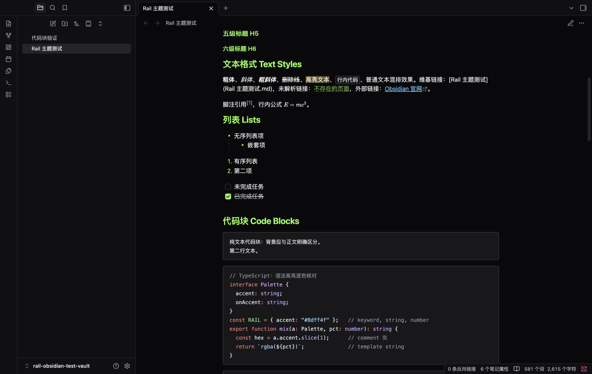
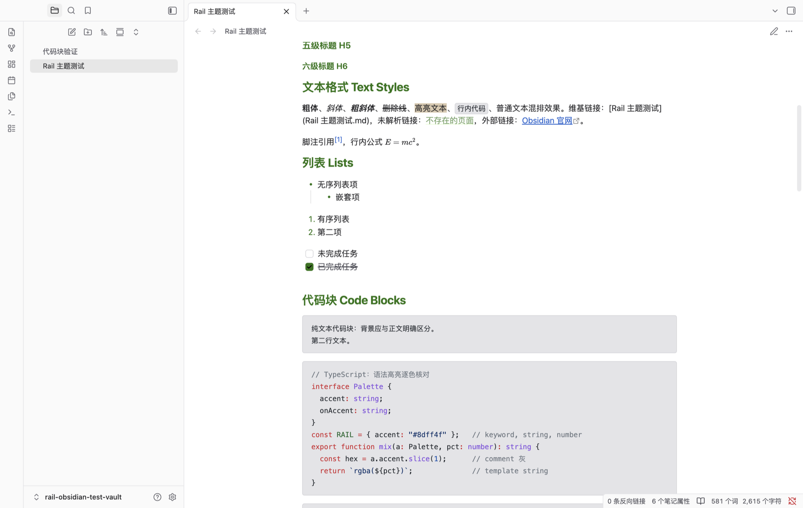

# Rail Theme

An [Obsidian](https://obsidian.md) theme built from the palette of the
ThinkRail editor, shared with the
[rail-theme](https://github.com/minos-chertsfield/rail-theme) VS Code
extension so both editors look the same.





## Six palettes, one theme

The theme follows Obsidian's dark/light scheme switch by default:

- **Rail Dark** — acid green accent on zinc-black surfaces, GitHub-style syntax colors.
- **Rail Light** — paper white with a dark green accent.

Four more variants can be enabled with the
[Style Settings](https://github.com/mgmeyers/obsidian-style-settings) community
plugin under **Settings → Style Settings → Rail Theme**:

- **Rail High Contrast Dark / Light** — stronger borders, opaque selections.
- **Rail Minimal Dark / Light** — desaturated accents for quieter setups.

Dark palettes apply while Obsidian is in dark mode, light palettes in light
mode. Without Style Settings the base Rail Dark / Rail Light schemes are used.

## Install

**From the community directory** (recommended): Settings → Appearance →
Themes → Browse community themes → search "Rail".

**From source**:

```bash
git clone https://github.com/minos-chertsfield/rail-obsidian-theme.git \
  "path/to/vault/.obsidian/themes/Rail"
```

Then enable it under **Settings → Appearance → Themes**.

## What's themed

Built entirely on Obsidian's CSS variables — no element selectors, no
`!important`, works with every Obsidian version that ships the variables:

- Accent color, base color ramp, extended colors (red/orange/yellow/green/
  cyan/blue/purple/pink)
- Editor: text, headings, inline title, links, tags, lists, blockquotes,
  embeds, tables, properties, callouts, highlight, selection, caret
- Code blocks: background plus 12 syntax token colors
- UI chrome: ribbon, title bar, status bar, tabs, file explorer navigation,
  modals, checkboxes, toggles, sliders, pills, scrollbars, graph view, canvas

## Notes

- The palette comes from ThinkRail. This is an independent project, not
  affiliated with or endorsed by JetBrains.
- `theme.css` is generated by `scripts/generate_theme.py`. Edit the script,
  not the stylesheet.
- No fonts are bundled; community themes must not load remote assets.
  Install Geist / JetBrains Mono yourself if you want the original look.
- Community-theme compliant: no network calls, no `!important`, no `:has()`,
  linted with `stylelint-config-obsidianmd`.

Chinese version: [README.zh-CN.md](README.zh-CN.md)

## License

MIT
