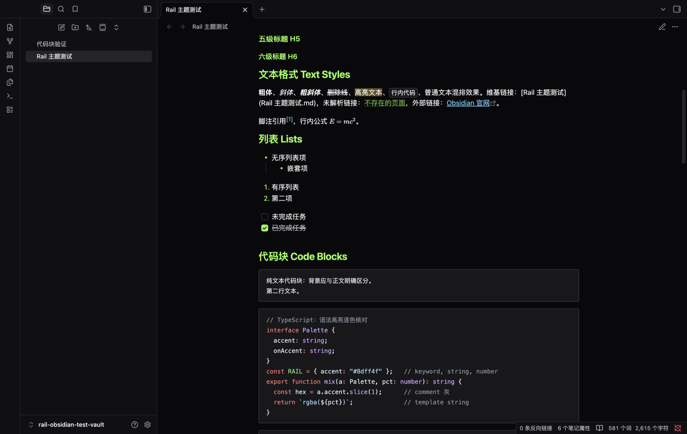
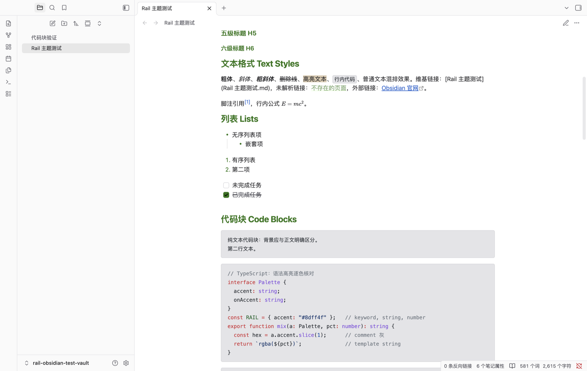

# Rail Theme 主题

一款基于 ThinkRail 编辑器配色的 [Obsidian](https://obsidian.md) 主题，与
[rail-theme](https://github.com/minos-chertsfield/rail-theme) VS Code
扩展共享同一套调色板，让两个编辑器外观保持一致。





## 六套配色，一个主题

默认跟随 Obsidian 的深色/浅色切换：

- **Rail Dark** —— 酸性绿点缀 + zinc 黑灰表面，GitHub 风格语法高亮。
- **Rail Light** —— 纸白背景 + 深绿点缀。

另外四套变体可通过社区插件
[Style Settings](https://github.com/mgmeyers/obsidian-style-settings)
启用（**设置 → Style Settings → Rail Theme**）：

- **Rail High Contrast Dark / Light** —— 更强的边框、不透明选区。
- **Rail Minimal Dark / Light** —— 低饱和度点缀，更安静的观感。

深色配色仅在 Obsidian 处于深色模式时生效，浅色同理。未安装 Style
Settings 时使用默认的 Rail Dark / Rail Light。

## 安装

**社区主题目录**（推荐）：设置 → 外观 → 主题 → 浏览社区主题 → 搜索 "Rail"。

**从源码安装**：

```bash
git clone https://github.com/minos-chertsfield/rail-obsidian-theme.git \
  "path/to/vault/.obsidian/themes/Rail"
```

然后在 **设置 → 外观 → 主题** 中启用。

## 覆盖范围

完全基于 Obsidian 的 CSS 变量实现 —— 不使用元素选择器、不使用
`!important`，与所有提供这些变量的 Obsidian 版本兼容：

- 强调色、基础色阶、扩展色（红/橙/黄/绿/青/蓝/紫/粉）
- 编辑器：正文、标题、行内标题、链接、标签、列表、引用、嵌入、表格、
  属性面板、callout、高亮、选区、光标
- 代码块：背景色 + 12 类语法 token 颜色
- 界面：侧边栏、标题栏、状态栏、标签页、文件导航、弹窗、复选框、开关、
  滑块、pill、滚动条、关系图谱、Canvas

## 说明

- 调色板来自 ThinkRail。本主题为独立项目，与 JetBrains 无关，也未经其认可。
- `theme.css` 由 `scripts/generate_theme.py` 生成，请改脚本而不是改样式文件。
- 不内置字体；社区主题不允许加载远程资源。想要原版观感请自行安装
  Geist / JetBrains Mono。
- 符合社区主题规范：无网络请求、无 `!important`、无 `:has()``，
  使用 `stylelint-config-obsidianmd` 进行 lint。

English version: [README.md](README.md)

## 许可证

MIT
